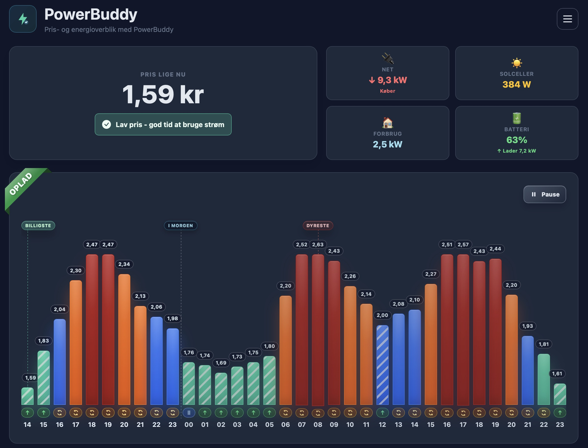
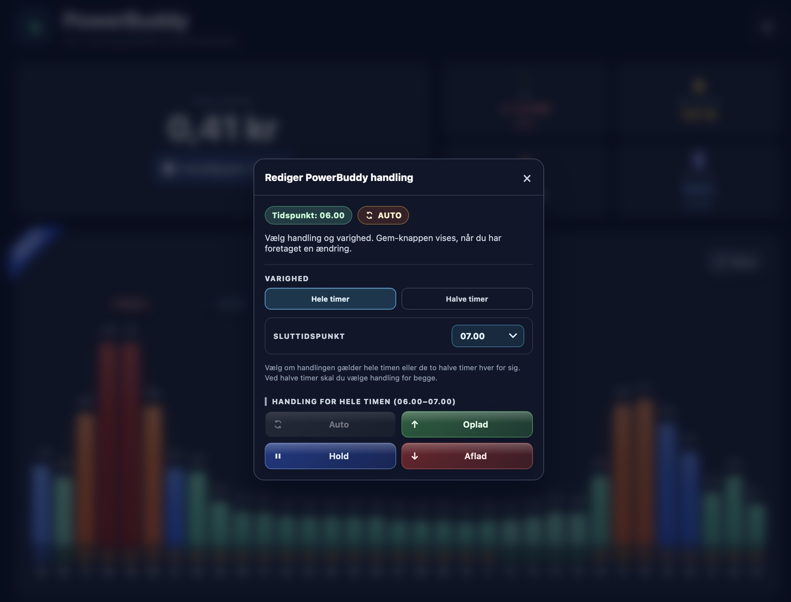
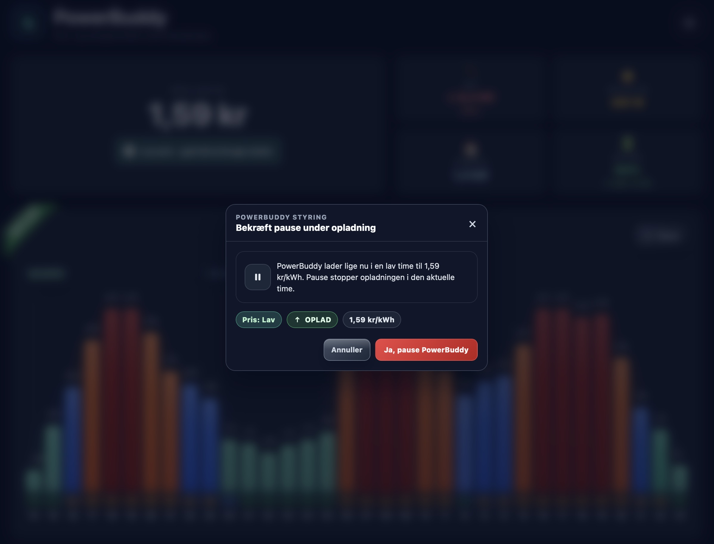
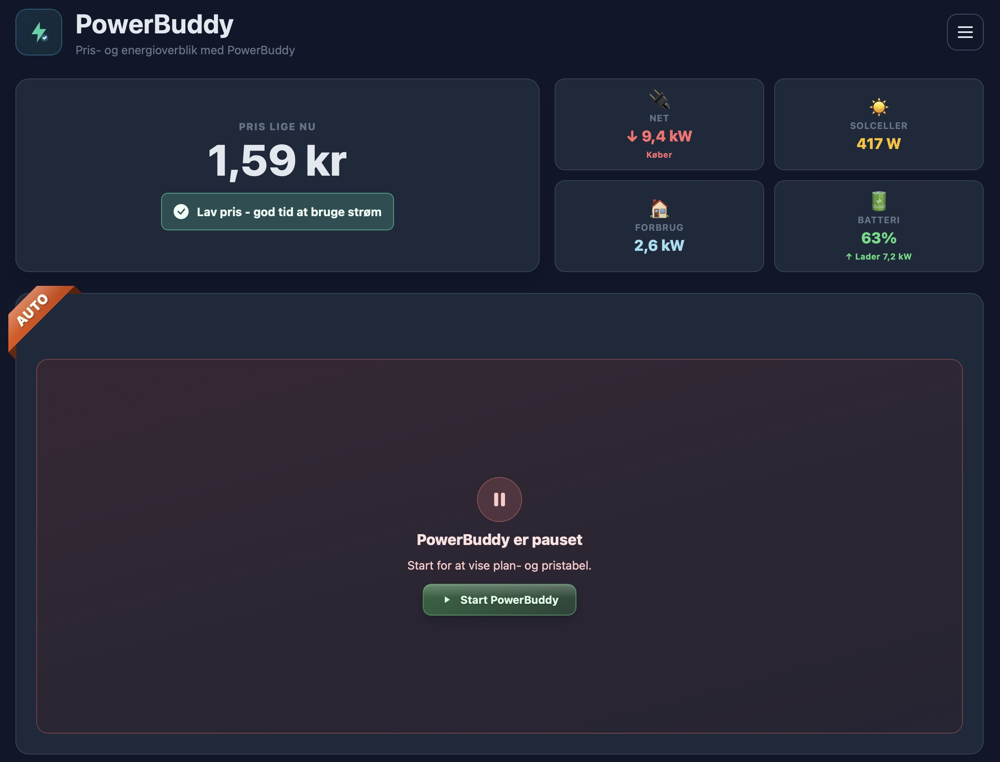
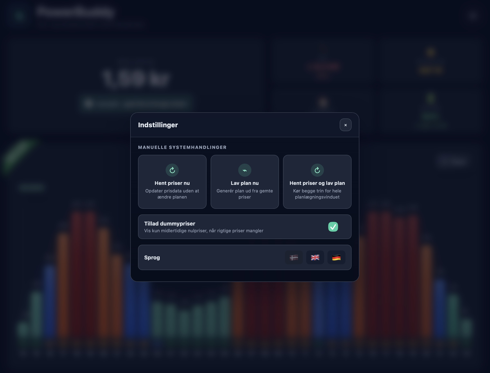

# VNS.PowerBuddy

<p align="left">
  
</p>

VNS.PowerBuddy is a backend service for smart battery and energy planning.

GitHub About (short description):

`Smart home battery optimizer with day-ahead planning, spot-price aware scheduling, and real-time inverter control.`

## Screenshots

<p align="center">
  
  
</p>

<p align="center">
  
  
</p>

<p align="center">
  
</p>


Core capabilities:

- Continuously fetches spot prices.
- Reads real-time inverter telemetry (default: Fronius Gen24 API).
- Generates day plans for battery actions (`charge` / `hold` / `discharge`).
- Weather-based PV production forecasting (Open-Meteo cloud/radiation API).
- Seasonal consumption anchoring with configurable monthly reference values.
- Weekday/weekend consumption profiling.
- Multi-scenario robust planning (low/base/high PV and consumption scenarios).
- Battery efficiency and cycle degradation cost modelling.
- Solar capture hold mode — allows PV charging in hold without grid draw.
- Intraday guarded re-planning when consumption deviates from expectations.
- KPI tracking and automatic consumption tuning based on historical accuracy.
- Accurate SOC projection for future-day planning (simulates today's remaining plan).
- Reserve SOC protection windows (configurable hours, e.g. evening peak).
- Stores prices, power snapshots, plans, and simulations in SQLite.
- Supports manual plan overrides through the API.
- Keeps existing day plans stable unless changed manually.
- Includes a native FastAPI dashboard (`/dashboard`) for live overview, plan edits, and execution control.
- Optional Fronius Wattpilot Flex Pro charge-state display.
- Winter rule: the four cheapest hours always charge, plus extra cheap hours in the overnight window.
- Half-hour planning: each hour can hold one action or two different actions (first/second half), shown with split icons in the chart.
- Multi-hour edits: choose whole hours and an end time in the planning dialog to apply one action to several consecutive hours, with a progress spinner while saving.
- Stripes mark every non-`auto` action (planned or manual) in the chart.
- Full-battery protection: an active `charge` period (hour or half hour, planned or manual) becomes `hold` when the battery is full; later charge points are evaluated when they become active.
- Dashboard language switch (🇩🇰 🇬🇧 🇩🇪) in the settings dialog, persisted to `.env` without a service restart.
- Self-update: the menu always shows the running version and, when a newer GitHub release exists, an update button (`Update 1.0.16 → 1.0.17`). It installs the release tag with the service's own `pip` (via `systemd-run`) and restarts `powerbuddy.service`; output goes to `update.log` next to the database. Override with `POWERBUDDY_UPDATE_REPO` / `POWERBUDDY_SERVICE_NAME`.

## Compatibility

This release (`v1.0.20`) targets Fronius-based installations and uses Fronius local API endpoints for telemetry/control.

Current status:

- Officially supported: Fronius inverter (Gen24/API-compatible setup).
- Field-tested: Fronius + BYD battery.
- Other battery systems behind Fronius may work but are not verified yet.

If you run a different hardware combination, validate in a test environment before production use.

## Architecture

- `src/powerbuddy/services/pricing.py`: Price provider interface and implementations (`energidataservice`, `elprisenligenu`).
- `src/powerbuddy/services/inverter.py`: Inverter interface and Fronius implementation.
- `src/powerbuddy/services/planner.py`: Planning and simulation engine.
- `src/powerbuddy/repositories.py`: Data access layer.
- `src/powerbuddy/main.py`: FastAPI application and endpoints.
- `src/powerbuddy/services/scheduler.py`: Background jobs (price refresh, snapshots, execution).
- `src/powerbuddy/dashboard_ui.py`: Dashboard HTML rendering and icon/asset injection.
- `src/powerbuddy/services/wattpilot.py`: Optional Wattpilot Flex Pro status polling.

## Quick Start

1. Create a virtual environment and install:

```bash
python3 -m venv .venv
source .venv/bin/activate
pip install -U pip
pip install -e .
```

2. Create your local environment file:

```bash
cp .env.example .env
```

The active runtime config file is `.env` in the project root.

3. Start the API:

```bash
uvicorn powerbuddy.main:app --host 0.0.0.0 --port 8000
```

4. Health check:

```bash
curl http://localhost:8000/health
```

5. Open API docs in your browser:

- `http://localhost:8000/swagger`

## Build And Release

Local run with Makefile:

```bash
make install
make run
```

Build wheel:

```bash
make build
```

Versioning:

- `VERSION` is the release version.
- `pyproject.toml`, `src/powerbuddy/__init__.py`, and the FastAPI app version should stay aligned.
- Dashboard static assets are packaged from `src/powerbuddy/static/`, including nested `css/` and `scripts/` files.

CI:

- GitHub Actions workflow: `.github/workflows/ci.yml`.

The dashboard modal regression tests use Node.js 18 or newer and need no npm
packages (Node.js is not required to run the application):

```bash
node --test tests/dashboard-modals.test.js
```

## Deployment Model (Production)

The service is intended to run from an installed Python package in a virtual environment, not directly from the `src` tree on the server.

That means:

- Runtime code lives in `.../.venv/lib/pythonX.Y/site-packages/powerbuddy/`.
- Service starts via `uvicorn powerbuddy.main:app` from the venv.
- Server only needs:
  - `/.venv` (runtime + packages)
  - `/data` (SQLite/data files)
  - `/.env` (configuration)

### Apache Reverse Proxy Example

If you want to expose the dashboard under a path like `/powerbuddy` behind Apache, use a reverse proxy to the local FastAPI service.

Example:

```apache
# The main dashboard proxy also covers /powerbuddy/static/*.
ProxyPass /powerbuddy http://127.0.0.1:8000/dashboard nocanon
ProxyPassReverse /powerbuddy http://127.0.0.1:8000/dashboard
```

Notes:

- No, you do not need one `ProxyPass` per dashboard sub-route. `ProxyPass /powerbuddy ...` already works like a wildcard for `/powerbuddy/*` and forwards those requests to `/dashboard/*`.
- With the current setup in this README, the public dashboard assets and icons live under `/powerbuddy/static/...`, which Apache forwards to the app's internal `/dashboard/static/...` mount.
- This keeps Apache config small and avoids separate icon or asset alias rules.

## API Overview

Swagger/OpenAPI:

- `GET /swagger`
- `GET /openapi.json`
- `GET /redoc`

Selected endpoints:

- `GET /`
- `GET /health`
- `GET /config`
- `POST /prices/fetch?target_date=YYYY-MM-DD`
- `GET /prices?target_date=YYYY-MM-DD`
- `GET /prices` (default: current hour + 24 hours ahead)
- `GET /tariff`
- `PUT /tariff/config`
- `PUT /tariff/manual-hours`
- `DELETE /tariff/manual-hours`
- `GET /inverter/realtime`
- `GET /planning?target_date=YYYY-MM-DD`
- `PUT /planning`
- `PUT /planning/action/{action_id}`
- `DELETE /planning/action/{action_id}`
- `POST /planning/override`
- `POST /planning/simulate?target_date=YYYY-MM-DD`
- `GET /planning/now`
- `GET /planning/chart-data?target_date=YYYY-MM-DD`
- `GET /execution/status`
- `POST /execution/pause`
- `POST /execution/start`
- `GET /dashboard`
- `GET /dashboard/state`
- `GET /dashboard/auth/status`
- `POST /dashboard/auth/login`
- `POST /dashboard/auth/logout`
- `POST /dashboard/control`
- `POST /dashboard/planning/action/{action_id}`

`PUT /planning/action/{action_id}` accepts `duration` (`full`, `first_half`, `second_half`) and an optional `other_action` to set the opposite half of the hour to a different action.

## Runtime Configuration

- `GET /config` returns the effective runtime settings loaded from `.env` at startup.
- Runtime config is not updated through database writes or API config persistence.
- Changes in `.env` require a service restart to take effect (except `POWERBUDDY_UI_LANGUAGE`, which the dashboard settings dialog applies immediately).
- `.env` is local and should not be committed.

Dashboard access configuration:

- `POWERBUDDY_DASHBOARD_ENABLED`: enables or disables the native dashboard route.
- `POWERBUDDY_DASHBOARD_SECRET`: optional quick-login secret (`/dashboard?secret=...`).
- `POWERBUDDY_DASHBOARD_PASSWORDS`: comma-separated dashboard passwords.
- `POWERBUDDY_DASHBOARD_TRUSTED_IPS`: comma-separated IPs with automatic access.
- `POWERBUDDY_DASHBOARD_SESSION_COOKIE`: dashboard session cookie name.
- `POWERBUDDY_DASHBOARD_SESSION_TTL_SECONDS`: dashboard session lifetime.
- `POWERBUDDY_DASHBOARD_ICON_URL`, `POWERBUDDY_DASHBOARD_FAVICON_URL`, `POWERBUDDY_DASHBOARD_APPLE_TOUCH_ICON_URL`: icon asset paths. Leave empty to use packaged local defaults under `/powerbuddy/static/...`.

Notes:

- The battery overview link on the dashboard is only clickable for logged-in dashboard sessions.
- `.env.example` documents the main runtime knobs; omitted keys continue to use code defaults from `src/powerbuddy/config.py`.

Dashboard language:

- `POWERBUDDY_UI_LANGUAGE`: dashboard UI language, `DK` (default), `EN` or `DE`. Unknown values fall back to Danish.
- All UI labels live in `src/powerbuddy/locales/<code>.json` (`da.json` is the master and fallback for missing keys).
- To add a language: copy `da.json` to `<code>.json`, translate the values (keep keys and `{placeholders}`), and add the env value to `_LANGUAGE_ALIASES` in `src/powerbuddy/i18n.py`. `tests/test_i18n.py` checks that all languages share the same keys.

Fronius Wattpilot Flex Pro integration (optional):

- `POWERBUDDY_WATTPILOT_ENABLED`: enable Wattpilot status polling (`true`/`false`).
- `POWERBUDDY_WATTPILOT_STATUS_URL`: local Wattpilot endpoint that returns its current state.
- `POWERBUDDY_WATTPILOT_TIMEOUT_SECONDS`: HTTP timeout for the Wattpilot status request.
- `POWERBUDDY_WATTPILOT_POLL_INTERVAL_SECONDS`: minimum time between Wattpilot status requests.

Scheduler behavior:

- Price refresh cadence is controlled by `POWERBUDDY_PRICE_RECHECK_INTERVAL_MINUTES`.
- Day-ahead fetch timing is controlled by `POWERBUDDY_DAY_AHEAD_PUBLISH_HOUR_LOCAL`.
- Planning horizon is controlled by `POWERBUDDY_PLANNING_HORIZON_HOURS` (minimum effective horizon is 48 hours).
- Automatic planning is regenerated only when fetched prices for a day actually change.
- After prices are fetched and unchanged, plans stay locked unless edited manually.

Battery power limits:

- `POWERBUDDY_MAX_CHARGE_KW` and `POWERBUDDY_MAX_DISCHARGE_KW` now accept either a numeric value or `auto`.
- `auto` uses the BYD HVM charge/discharge table based on battery capacity discovered from the inverter at startup: 8.3->4.51 kW, 11.0->5.63 kW, 13.8->6.76 kW, 16.6->7.88 kW, 19.3/22.1->9.01 kW.
- If inverter capacity discovery is unavailable, the fallback profile is HVM 13.8.
- Battery SOC bounds are fixed in code (min 5%, max 100%).
- Legacy keys `POWERBUDDY_BATTERY_CAPACITY_KWH`, `POWERBUDDY_BATTERY_MIN_SOC`, `POWERBUDDY_BATTERY_MAX_SOC`, `POWERBUDDY_PLANNED_CHARGE_KW`, and `POWERBUDDY_DEFAULT_CHARGE_POWER_W` are no longer required.

## Consumption Model

### Optional Claude planning proposals

Set `POWERBUDDY_CLAUDE_API_KEY` in `.env` and restart the service, or paste the key
under **Settings → AI planning (Claude)** in the dashboard, to enable Claude
price-based proposals for scheduled replanning, dashboard plan creation and chart
bootstrap. The dashboard verifies the key against Anthropic's model list, stores it
in `.env` (mode 600) without a restart and never sends it back to the browser;
**Remove** clears it again. With a key, **Create plan now** and **Fetch prices and
create plan** always create a new plan through Claude (even when prices are unchanged),
**Fetch prices now** re-plans the fetched days through Claude, and all three report
for how many days the AI proposal was accepted. Leave the key empty to
use the local planner without an AI request.
`POWERBUDDY_CLAUDE_MODEL` defaults to `claude-sonnet-4-6`;
`POWERBUDDY_CLAUDE_TIMEOUT_SECONDS` defaults to 45 seconds. API calls incur costs.
Verifying the key and model does not verify available API credit or spending limits.
Never commit the key. It is masked in settings representations and excluded from
settings serialization and `/config`.

Only public spot-price timestamps/values and general seasonal charging rules are
sent to Anthropic. Household consumption/history, telemetry, SOC, solar forecasts,
manual overrides, location, tariffs and other environment settings stay local.
No call is made for dummy/provisional prices. This is a constrained proposal
integration, not an autonomous agent with server or inverter access.

The local engine provides the baseline and evaluates both alternatives with the
same captured consumption and solar forecasts, starting SOC, tariffs and simulation
start time. Both alternatives go through the same processing used by the relevant
planning path, including applicable sanity checks, variant selection and trimming.
The comparison also includes the effective manual and locked actions; overrides
changed while waiting for Claude are refreshed before local validation. The selected
processed plan is the one saved and simulated. Locally scheduled charge slots
(including the winter cheapest-hour floor) are preserved against AI changes, and
hours containing manual or locked actions, including a manual half-hour, remain
private and are excluded from AI changes.

The simulation accounts for the actual duration of half-hours and the remaining
part of an active period. Expected daily consumption is normalized over the entire
local day, using 23- or 25-hour weights where applicable; solar charging respects
battery capacity and power limits, and surplus can be exported. Plan `target_soc`
values are projection hints, not inverter-enforced stops, so they do not artificially
clamp the simulated battery level. If a complete
proposal worsens simulated cost, battery reserve or expensive-hour grid purchases,
a local heuristic tests subsets of its changes against the same constraints. A
partial proposal is used only if its simulated cost is more than 0.01 øre lower
and an AI-suggested action survives processing. No extra Claude request or private
data is needed. If no qualifying subset is found, the local baseline is used.
Duplicate wall-clock price slots reaching Claude planning fall back to the existing
planner. The current price store is keyed by wall time and retains only one
occurrence of a repeated autumn hour.

Local logs record the baseline and proposed objective in øre, including battery
wear, and the objective of a selected partial proposal. API errors, timeouts and
invalid/rejected proposals are logged; accepted full or partial proposals are also
logged. These values are estimates, not a guarantee of the actual bill. The
heuristic is not guaranteed to find an improvement, and the accepted count is
corrected if no Claude change survives final processing.
Known HTTP errors are logged as safe diagnostic categories without logging API
responses, keys or prompts; unrecognized errors retain only the HTTP status.

- Base value: `POWERBUDDY_EXPECTED_DAILY_CONSUMPTION_KWH`.
- Dynamic mode: when `POWERBUDDY_DYNAMIC_CONSUMPTION_ENABLED=true`, the planner uses a rolling average of historical daily consumption from `power_snapshots`.
- In the non-summer season, the planner selects the four cheapest available charge slots plus up to two additional cheap slots in the overnight window (00:00-05:00 by default). Current-day replanning only considers the remaining hours. These required slots are protected from automatic sanity and trimming passes; manual overrides still take precedence, and an active charge converts to hold when the battery is full. Additional safety or reserve charge slots may still be added when SOC and consumption require them.
- Lookback window: `POWERBUDDY_DYNAMIC_CONSUMPTION_LOOKBACK_DAYS`.
- Minimum sample requirement per day: `POWERBUDDY_DYNAMIC_CONSUMPTION_MIN_SAMPLES_PER_DAY`.
- Seasonal anchoring: when `POWERBUDDY_SEASONAL_ANCHOR_ENABLED=true`, the dynamic value is blended with a monthly reference (`POWERBUDDY_SEASONAL_ANCHOR_MONTHLY_DAILY_KWH_JSON`).
- Weekday/weekend split: when enabled, separate consumption profiles are used for weekdays vs. weekends.
- PV production: weather-scaled hourly PV profile fetched from Open-Meteo; net consumption (household minus PV) is used in the planner.

## Example: Manual Override

```json
{
  "date": "2026-04-14",
  "start_time": "2026-04-14T16:00:00+02:00",
  "end_time": "2026-04-14T17:00:00+02:00",
  "action": "hold",
  "target_soc": 65,
  "reason": "preserve SOC during peak load"
}
```

## Roadmap

- Expanded tariff/fee handling.
- Profit optimization based on export/import pricing.
- More inverter adapters (Deye, Huawei, Tesla Powerwall, others).
